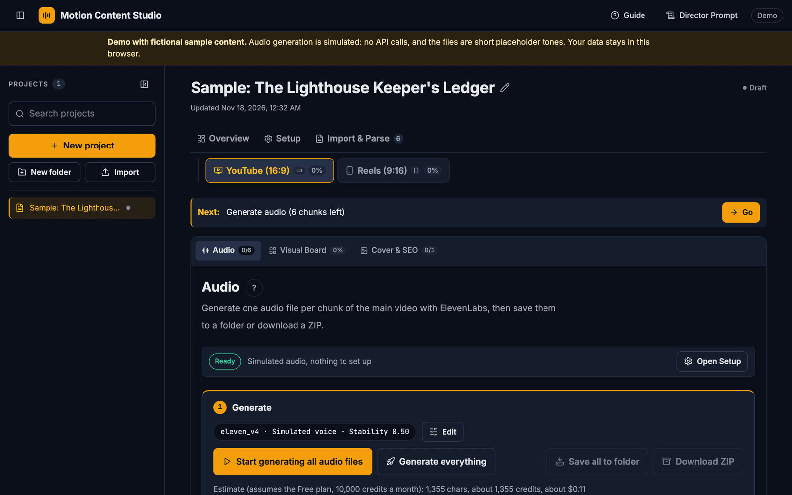
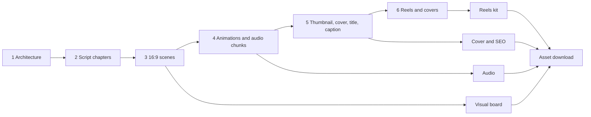
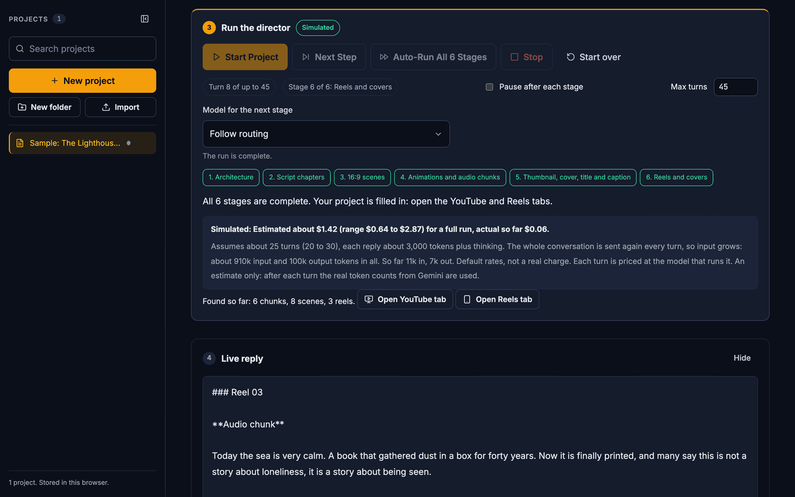
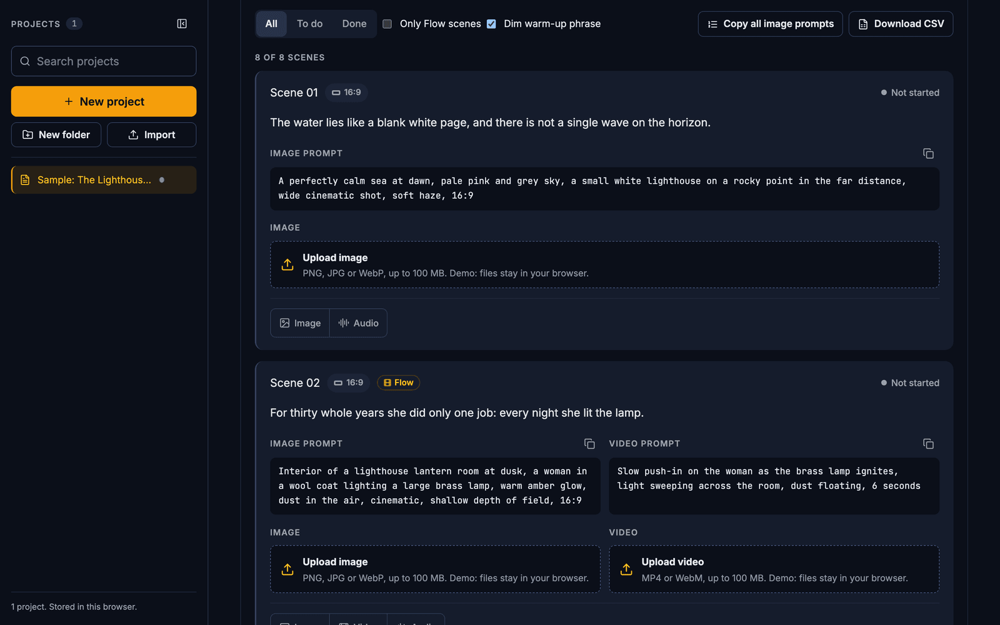
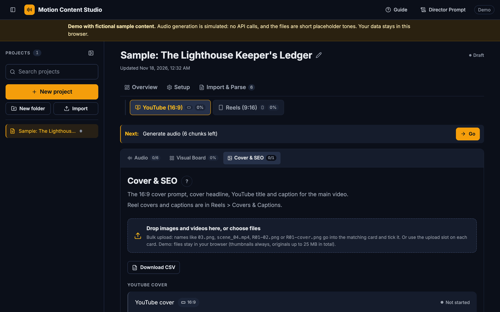
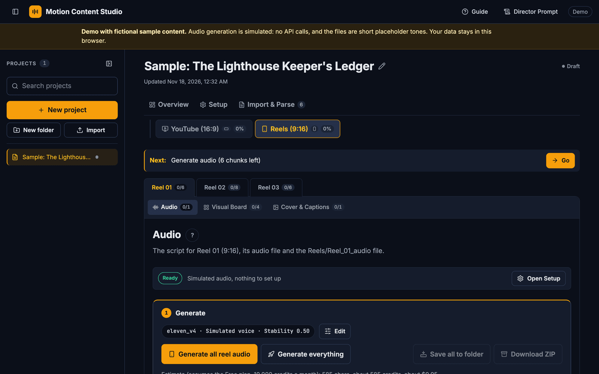
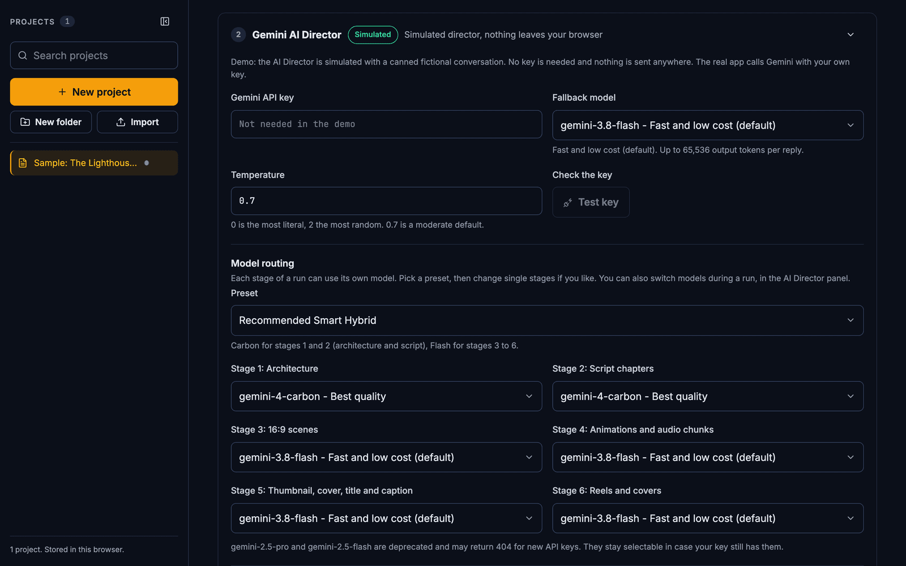
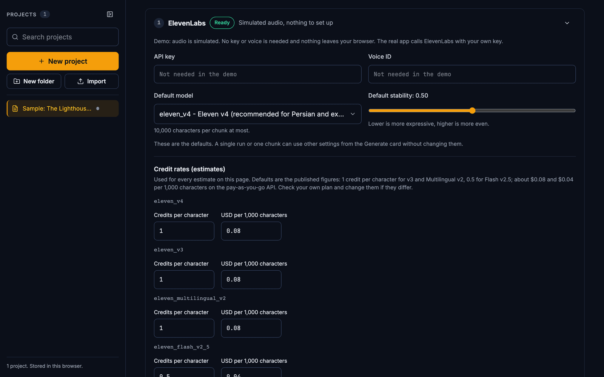
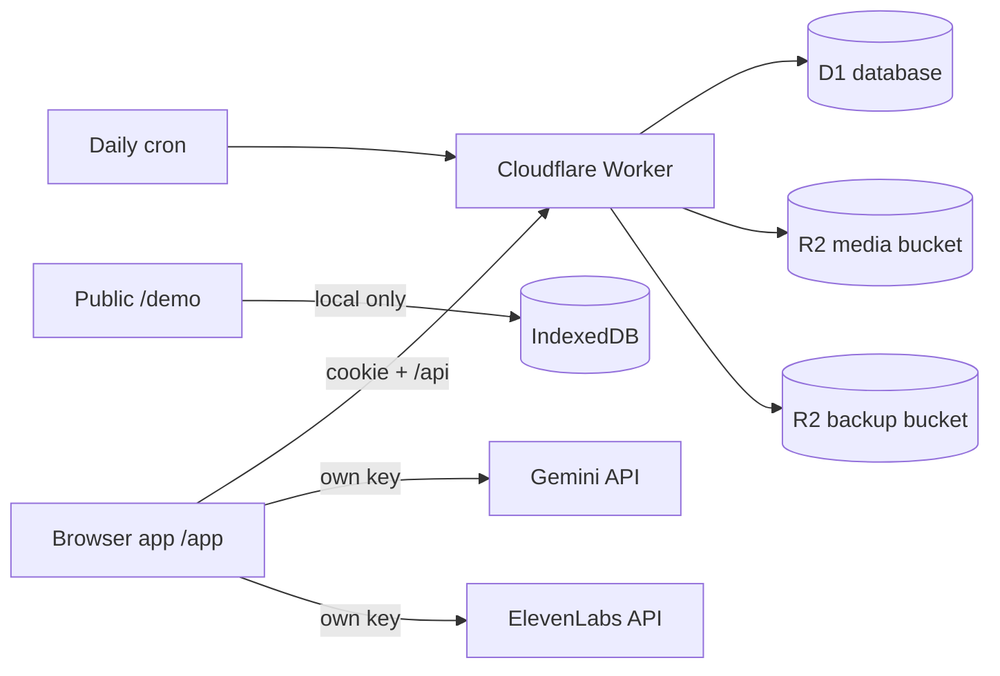

# Motion Content Studio

Turn a book into a finished video kit: an AI Director writes the script, scenes and reels, and the app turns them into narration audio, a visual board, covers and publishing text.

[Live demo](https://motioncontent.pooya.website/demo) | [Case study](https://pooya.website/work/motion-content-studio) | [Docs](#documentation)



## What it does

| Step | You do | The app produces |
|---|---|---|
| 1 | Add a book (PDF, title or summary) and press Auto-Run, or paste an existing conversation | The director conversation, parsed live |
| 2 | Review the narration | Audio chunks, ready for ElevenLabs |
| 3 | Generate voice | Numbered MP3 files with credit and cost estimates |
| 4 | Work through the board | 16:9 image prompts and animation prompts, one card each |
| 5 | Pick a cover | Thumbnail prompt, cover headline, YouTube title, caption |
| 6 | Plan the shorts | Three 9:16 reels with audio, images and covers |

## The AI Director pipeline



## Features

| Feature | Details |
|---|---|
| AI Director | Runs your Director Prompt on Gemini from the browser, six stages with Auto-Run, Pause and feedback. Per-stage model routing (presets or a dropdown per stage) and a cost per turn, priced at the model that ran it |
| Paste a conversation | A tolerant parser splits a pasted reply into chunks, scenes, animations, covers, text and reels. Re-parse keeps progress and uploaded files |
| ElevenLabs narration | Queue with retries, per-chunk 10 second preview, credit and USD estimates, plan usage, ZIP or folder save |
| Media | Per-card image and video uploads to R2 with 320 px thumbnails, a lightbox, bulk drop and Download all assets |
| Share links | Read-only prompt and progress page, expiring, revocable, no login for the viewer |
| Save bar | Explicit Save with version check and conflict detection (Reload or Overwrite) |
| First-run password | Created once with a recovery key, PBKDF2 hash in D1, signed cookie |
| Google sign-in (optional) | "Continue with Google" for one allowed email, server-side OIDC with PKCE; the password stays as fallback. See [docs/deploy.md](docs/deploy.md) |
| Daily backups | Cron dump of D1 plus incremental media copy, restore script |
| Demo mode | `/demo` runs the whole flow on fictional content, entirely in your browser |

More detail: [docs/features.md](docs/features.md).

## Screenshots

<table>
  <tr>
    <td width="33%"><a href="docs/images/ai-director.png"></a><br><sub>AI Director, six stages</sub></td>
    <td width="33%"><a href="docs/images/visual-board.png"></a><br><sub>Visual board with upload slots</sub></td>
    <td width="33%"><a href="docs/images/cover-seo.png"></a><br><sub>Cover and SEO</sub></td>
  </tr>
  <tr>
    <td width="33%"><a href="docs/images/reels.png"></a><br><sub>Reels (9:16), per reel audio</sub></td>
    <td width="33%"><a href="docs/images/setup-gemini.png"></a><br><sub>Gemini setup and model routing</sub></td>
    <td width="33%"><a href="docs/images/setup-elevenlabs.png"></a><br><sub>ElevenLabs setup and credit rates</sub></td>
  </tr>
</table>

The layout also works on a phone: [mobile view](docs/images/mobile.png).

## Architecture



API keys stay in your browser and go straight to Gemini and ElevenLabs, never through the Worker. See [docs/architecture.md](docs/architecture.md).

> **Data safety.** D1 Time Travel can rewind the database. A daily job writes a JSON dump of every table to a private backup bucket. Every media object is also copied to that bucket and never deleted there. See [docs/backups.md](docs/backups.md).

## Quick start

Requires Node 22 (`.nvmrc`); Node 20+ works.

```bash
npm install
npm run gen:recovery        # writes local secrets, nothing printed
npm run db:migrate:local    # creates the local D1 tables
npm run dev                 # http://localhost:8787
```

`npm run dev` runs `wrangler dev --infer-origin-from-routes=false`. Keep that flag: otherwise wrangler rewrites the host and the local Dev sign in never shows. For one-click local sign in, put `DEV_LOGIN=1` in `.dev.vars` (never in production). Open `/demo` with no login, or `/app` after creating the password. More in [docs/development.md](docs/development.md).

## Deploy

1. `npx wrangler login`
2. Set `RECOVERY_KEY` and `SESSION_SECRET` with `wrangler secret put`.
3. Create the D1 database and the two R2 buckets, and paste the database id into `wrangler.jsonc`.
4. `npm run db:migrate:remote`
5. `npm run deploy`
6. Open `/login`, and create the password (`POST /login` is rate limited by the built-in `LOGIN_LIMIT` binding, no dashboard rule needed).

Full steps, custom domain and prompt seeding: [docs/deploy.md](docs/deploy.md).

## Tests

```bash
npm test      # 347 unit and integration tests (jsdom suites need JSDOM_PATH)
npm run e2e   # Playwright, desktop and mobile
```

See [docs/testing.md](docs/testing.md).

## Tech stack

Vanilla JavaScript client (no build step), Tailwind (CDN), Cloudflare Workers with static assets, D1, R2, Cron Triggers, Gemini and ElevenLabs APIs, Node test runner with jsdom, Playwright.

## Documentation

| Doc | Contents |
|---|---|
| [docs/features.md](docs/features.md) | Full behaviour reference |
| [docs/architecture.md](docs/architecture.md) | Storage, save and conflict flow, auth, share links, API routes |
| [docs/input-format.md](docs/input-format.md) | What the parser expects |
| [docs/deploy.md](docs/deploy.md) | Cloudflare setup and secrets |
| [docs/backups.md](docs/backups.md) | Daily backup and restore |
| [docs/development.md](docs/development.md) | Dev flags, DEV_LOGIN, cache busting, layout |
| [docs/testing.md](docs/testing.md) | Unit and browser tests |
