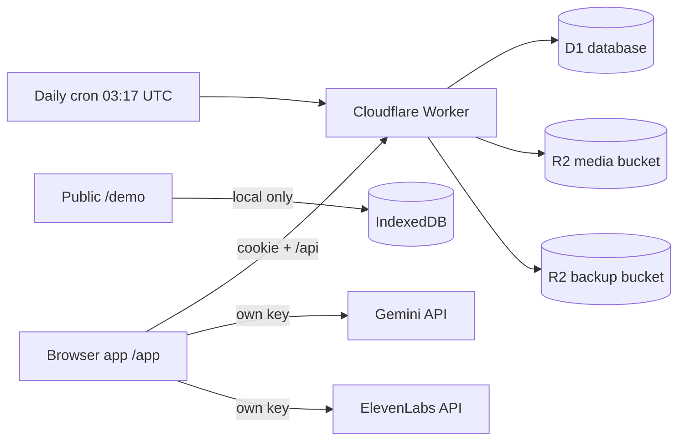
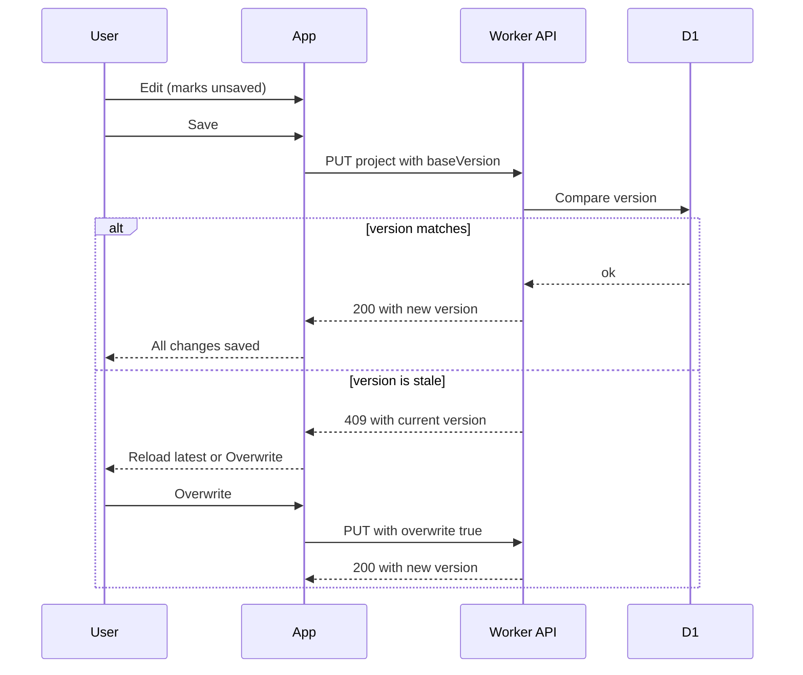

# Architecture

The app is a browser client with a small Cloudflare Worker behind it. The Worker serves static files, gates `/app`, and exposes a storage API over D1 and R2. AI and voice calls never go through the Worker.

## Storage model

| Where | What |
|---|---|
| D1 `motion-books` (binding `DB`) | Projects, folders, media metadata, share links, settings (including the Director Prompt vault), the password row. Migrations in `migrations/` (`0001_init` to `0006_project_version`). |
| R2 `motion-books-audio` (binding `AUDIO`) | Generated audio (`audio/<projectId>/<key>.<mp3\|wav>`), uploaded originals (`media/<project>/<sk>`) and their thumbnails. Streamed, never zipped on the server. |
| R2 `motion-books-backups` (binding `BACKUP`) | Daily database dump and an incremental copy of media. See [backups](backups.md). |
| Browser `localStorage` | API keys and settings (`mbs_app:*`), navigation state. Keys are sent only to their own provider. |
| Browser IndexedDB | `/demo`: everything (`mbs_demo_db`). `/app`: only File System Access folder handles (`mbs_app_cache_db`). |

`/demo` uses the local adapter and makes no `/api` calls. `/app` uses `remote-store.js`, the only script that calls `/api`. The server is the only source of truth in `/app`: a project is loaded from the server every time it is opened.

## Save and conflict flow

Every write bumps `projects.version`. The client sends the version it last saw as `baseVersion`.

`PATCH` (rename, move, status) returns the new version. Details of the Save bar, immediate actions and leave warnings are in [features](features.md).

## Auth

- The password lives in D1 (one row, migration `0005_auth.sql`) as PBKDF2-SHA256 with a random per-install salt and 100,000 iterations (the Workers maximum). Compares are constant time.
- A correct sign-in sets an `HttpOnly`, `Secure`, `SameSite=Lax` cookie signed with HMAC-SHA256 (`SESSION_SECRET`), valid 30 days, carrying a session epoch stored in the auth row. `/logout` clears it. Unauthenticated `/app*` redirects to `/login`.
- First run: until a password exists, `/login` shows Create password. It needs the `RECOVERY_KEY` secret, 10+ characters and a confirmation, and works once only (a second attempt gets 409).
- Change password (`/login?mode=change`) needs the current password. Forgot password (`/login?mode=forgot`) needs `RECOVERY_KEY`. Both bump the epoch, so other sessions are signed out.
- Failed attempts are slowed and locked out after 5 misses in 15 minutes per IP. The counter lives in isolate memory (best effort), so it is the second layer. The first is the `LOGIN_LIMIT` Workers Rate Limiting binding: every `POST /login` is limited per `CF-Connecting-IP` (10 per 60 seconds, 429 with `Retry-After: 60`) before any hashing or D1 work, and skipped if the binding is absent. It replaces a dashboard rule because the Free plan allows only one WAF rate-limiting rule.
- `/app` and `/login` send `noindex` and `no-store`; `robots.txt` disallows them. The landing page, `/demo` and `/format` are indexable.
- `LOGIN_DELAY_MS` (optional var) overrides the failed-attempt delay; tests set it to 0. Secrets are never logged.

## Share links

`/s/<token>` (`src/share.js`) is a public, read-only page. The token is 32 random bytes and only its SHA-256 is stored, so the link is shown once. Expiry is 1, 7 (default) or 30 days; one live link per project; deleting the project removes it. The page is rendered server-side from an allowlist (image, video and cover prompts and which items are done; no narration, audio, notes, titles, captions or project name). Responses carry `X-Robots-Tag: noindex, nofollow`, `Referrer-Policy: no-referrer`, `Cache-Control: no-store` and a strict CSP, with no JavaScript. Unknown, expired and revoked tokens all answer the same 404. The route shares the `API_LIMIT` rate limit (keyed `share:<ip>`).

## API guards

Applied to every `/api/*` route in this order: not signed in gives 401 JSON (never a redirect); per-IP rate limit (`API_LIMIT`, 120 per minute, 429 with `Retry-After`, skipped if the binding is absent); writes need `Origin` equal to the site and header `X-MBS: 1` (else 403); JSON routes need `application/json`, audio routes `audio/mpeg` or `audio/wav` (else 415); `Content-Length` is checked before the body is read (413 over the caps: body 1.9 MB, text 900 KB, parsed 700 KB, state plus info 200 KB each 1.8 MiB together, audio 8 MB). Responses are `private, no-store`. Audio keys match `^(\d{1,4}|reel:[\w-]{1,40})$`.

## API routes

All routes are signed-in only, except share pages.

| Route | Methods | Purpose |
|---|---|---|
| `/api/projects` | GET | Summaries: id, name, folder, status, dates, version |
| `/api/projects/:id` | GET, PUT, PATCH, DELETE | Full project; PUT checks `baseVersion` (409 on stale, `overwrite: true` skips); PATCH renames, moves or sets status |
| `/api/projects/:id/shares` | GET, POST, DELETE | Create, read or revoke the share link |
| `/api/projects/:id/media` | GET | List media |
| `/api/projects/:id/media/:key` | GET, PUT, DELETE | Original file in R2; PUT streams, png jpeg webp mp4 webm, max 100,000,000 bytes; GET supports Range, ETag, `?download=1` |
| `/api/projects/:id/thumb/:key` | GET, PUT | 320 px WebP thumbnail |
| `/api/projects/:id/media-cleanup` | POST | Delete unused media after confirmation |
| `/api/projects/:id/audio/:key` | GET, PUT, DELETE | Generated audio in R2 |
| `/api/folders`, `/api/folders/:id` | GET, PUT, DELETE | Folders (deleting keeps their projects) |
| `/api/settings/director-prompt` | GET, PUT | Director Prompt vault (100 KB cap) |
| `/api/storage` | GET | Storage meter (media, thumbnails, audio bytes) |
| `/api/backup/status` | GET | Last backup run |
| `/api/backup/run` | POST | Run a bounded backup pass (refused within a minute of the last) |
| `/s/:token` | GET | Public read-only share page |

## Browser-side providers

- The Gemini key is sent only to `generativelanguage.googleapis.com` (`x-goog-api-key`). The ElevenLabs key is sent only to `api.elevenlabs.io`. Anyone with access to the browser profile can read them; use keys with a usage limit.
- ElevenLabs: `POST https://api.elevenlabs.io/v1/text-to-speech/{voice_id}?output_format=mp3_44100_128` with `xi-api-key` and a JSON body `{ text, model_id, voice_settings: { stability } }`.
- Models: `eleven_v4` (default, 10,000 characters per request, 1 credit per character), `eleven_v3` (5,000), `eleven_multilingual_v2` (10,000), `eleven_flash_v2_5` (40,000, half the credits). Longer chunks are rejected before any request is sent.
- Stability: `eleven_v3` takes only 0.0, 0.5 or 1.0; other models take 0 to 1 in steps of 0.05.
- Errors: 401, 402 and 404 stop the queue; 429, 5xx and network errors are retried up to 3 times with growing waits; 400 and 422 report the API message.
- Files are named `01_audio.mp3`, `02_audio.mp3` (demo files are `.wav`). Calls rely on ElevenLabs CORS support; if a browser or extension blocks them, the error shows as a network error.
- Re-check these against the provider docs if requests start failing.
- `public/static/*` is public by design and holds no secrets. Project data lives in D1 behind the login; treat the database and buckets as private.
